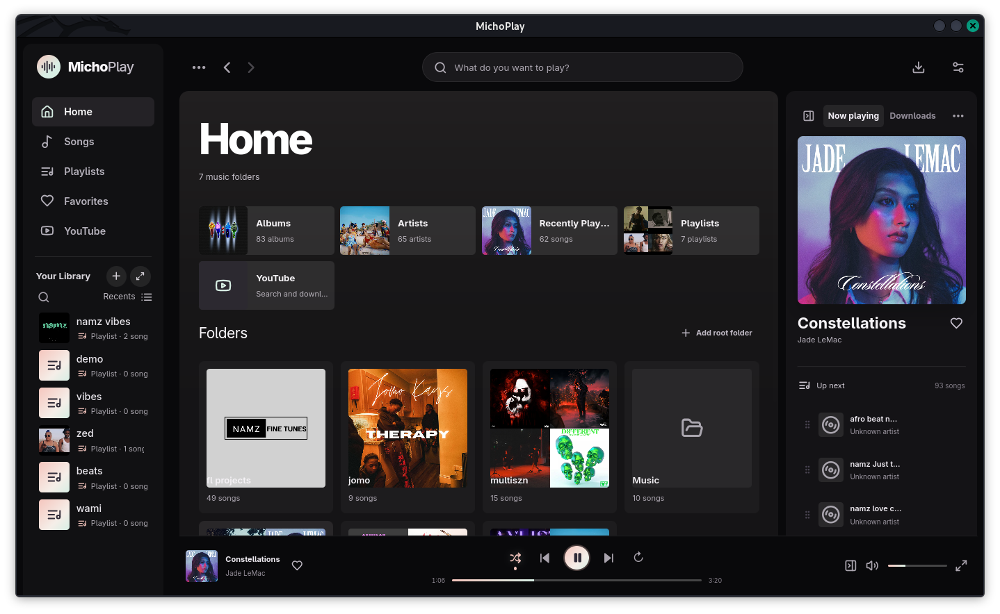
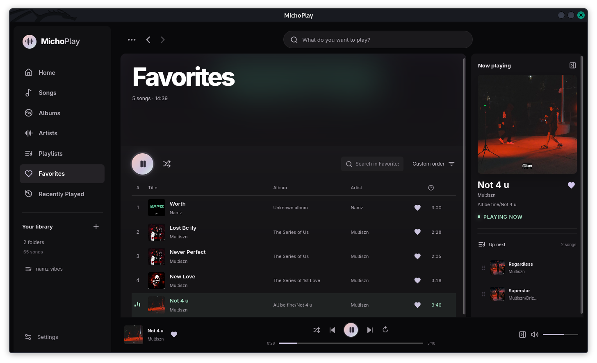
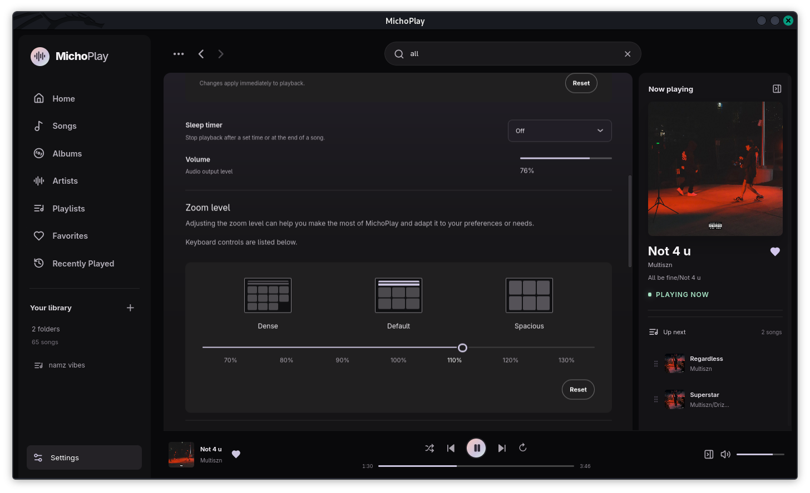

<p align="center">
  
</p>

<h1 align="center">MichoPlay</h1>

<p align="center"><strong>A Spotify-inspired local music player.</strong></p>
<p align="center">Play and organize the music you already own, with an offline-first library for desktop and Android.</p>

## Showcase

<p align="center">
  
</p>
<p align="center"><em>Home, local music folders, playback, and track actions</em></p>

<p align="center">
  
</p>
<p align="center"><em>Favorites, queue, and now playing</em></p>

<p align="center">
  
</p>
<p align="center"><em>Playback and appearance settings</em></p>

## Features

- Scan local music folders and browse songs, albums, artists, and folders with embedded artwork and tags.
- Create playlists, save favorites, search the library, and sort collections.
- Control playback with shuffle, repeat, an editable queue, an equalizer, and a sleep timer.
- Keep listening history and pick up from the last played track.
- Import audio on Android, keep imported files available across restarts, and use background playback controls.
- Use keyboard shortcuts and adjust the interface density and zoom.
- Keep your music library and listening data on your device; no streaming account is required.

MichoPlay is available for Linux, Windows, macOS, and Android.

<p align="center"><a href="https://github.com/namz182/michoplay/releases"><strong>Download the latest release</strong></a></p>

## Requirements

- Node.js 20.19+ or 22.12+ (Node 24 is also suitable)
- Rust stable and Cargo
- Platform dependencies for Tauri 2
- Android Studio, Android SDK, NDK, and a JDK to build or run the Android app

See the [Tauri prerequisites](https://v2.tauri.app/start/prerequisites/) for platform-specific requirements.

### Linux (Debian, Ubuntu, Kali)

Install Tauri’s Linux development libraries and MichoPlay’s ALSA headers:

```sh
sudo apt update
sudo apt install -y \
  build-essential curl wget file \
  libwebkit2gtk-4.1-dev libssl-dev libxdo-dev \
  libayatana-appindicator3-dev librsvg2-dev libasound2-dev
```

Install Rust with rustup if needed, then load Cargo into the current shell:

```sh
curl --proto '=https' --tlsv1.2 https://sh.rustup.rs -sSf | sh
source "$HOME/.cargo/env"
rustup default stable
```

If `cargo` is missing in a new terminal, run `source "$HOME/.cargo/env"` or open a new login shell. The Tauri command invokes `cargo metadata`, so Cargo must be on `PATH` before running it.

### Android

1. Install Android Studio and, in SDK Manager, install an Android SDK Platform, Platform Tools, Build Tools, Command-line Tools, and an NDK (Side by side).
2. Set the SDK, NDK, and Java paths in the shell used to build. Adjust the NDK version to one installed under `$ANDROID_HOME/ndk`:

```sh
export ANDROID_HOME="$HOME/Android/Sdk"
export NDK_HOME="$ANDROID_HOME/ndk/28.2.13676358"
export JAVA_HOME="$(dirname "$(dirname "$(readlink -f "$(command -v javac)")")")"
export PATH="$ANDROID_HOME/platform-tools:$PATH"
java -version
adb version
```

If `javac` is not on `PATH`, set `JAVA_HOME` to Android Studio’s bundled `jbr` directory (for example, `/opt/android-studio/jbr`).

3. Add the Android Rust targets:

```sh
rustup target add aarch64-linux-android armv7-linux-androideabi i686-linux-android x86_64-linux-android
```

The Android project is already checked in under `src-tauri/gen/android`. If setting up a fresh copy where that directory is missing, initialize it once with `npm run tauri android init`.

## Install dependencies

From the project root:

```sh
npm ci
```

## Run in development

### Desktop

```sh
npm run tauri dev
```

Tauri starts Vite for you on port `1420`. Run only one development server for this project at a time. If you see `Port 1420 is already in use`, stop the earlier `npm run dev` or `npm run tauri dev` with `Ctrl+C`. If that terminal is no longer available, find the process listening on the port and stop that process:

```sh
ss -ltnp | grep ':1420'
# Replace 12345 only after verifying that PID is the stale Vite process:
kill 12345
```

Then retry `npm run tauri dev`.

### Android device

Enable Developer options and USB debugging on the phone, connect it, and approve the debugging prompt. Confirm ADB can see it, then run the app:

```sh
adb devices
npm run tauri android dev
```

Choose the connected device if the CLI asks. Vite uses Tauri’s `TAURI_DEV_HOST` value for its mobile development server and HMR connection. The Android dev command starts the frontend server, builds the native app, installs it, and launches it on the device. Keep the terminal open while developing.

## Build release apps

### Linux

Run the build on Linux to create the selected package. Tauri places each bundle under `src-tauri/target/release/bundle/`.

```sh
npm run tauri build -- --bundles deb
npm run tauri build -- --bundles rpm
npm run tauri build -- --bundles appimage
```

### Windows

Build an MSI on Windows. WiX, which Tauri uses for MSI packages, only runs on Windows. On Windows, choose either installer:

```powershell
npm run tauri build -- --bundles msi
npm run tauri build -- --bundles nsis
```

#### Build a Windows NSIS installer from Kali/Linux

You can cross-compile the Windows setup `.exe` from Kali or another Debian-based Linux system. Install NSIS, LLVM, and LLD, then install the Windows Rust target and `cargo-xwin`:

```sh
sudo apt install -y nsis lld llvm
rustup target add x86_64-pc-windows-msvc
cargo install --locked cargo-xwin
```

Build with the Windows target and runner explicitly selected. Running `--bundles nsis` without these options builds for the current Linux system.

```sh
npm run tauri build -- --runner cargo-xwin --target x86_64-pc-windows-msvc --bundles nsis
```

The installer is created at `src-tauri/target/x86_64-pc-windows-msvc/release/bundle/nsis/`. MSI packages still need to be built on Windows. See the [Tauri Windows installer guide](https://v2.tauri.app/distribute/windows-installer/) for cross-compilation details and caveats.

### macOS

Run these commands on macOS to create an application bundle and disk image:

```sh
npm run tauri build -- --bundles app
npm run tauri build -- --bundles dmg
```

### Android APK or app bundle

Build APKs for local installation/testing:

```sh
npm run tauri android build -- --apk
```

Build an Android App Bundle for store distribution:

```sh
npm run tauri android build -- --aab
```

Outputs are under `src-tauri/gen/android/app/build/outputs/`. Install a generated APK on the connected phone with:

```sh
adb install -r /path/to/generated.apk
```

The release build runs the frontend build command automatically. For development, use `npm run tauri android dev` instead. Tauri’s desktop bundle targets are `deb`, `rpm`, `appimage`, `msi`, `nsis`, `app`, and `dmg`; see the [Tauri distribution guide](https://v2.tauri.app/distribute/) for platform requirements and bundle details.

Your library, playlists, playback queue, and listening history stay on your device. Desktop music files remain in their folders; Android imports are copied into MichoPlay’s app storage.
